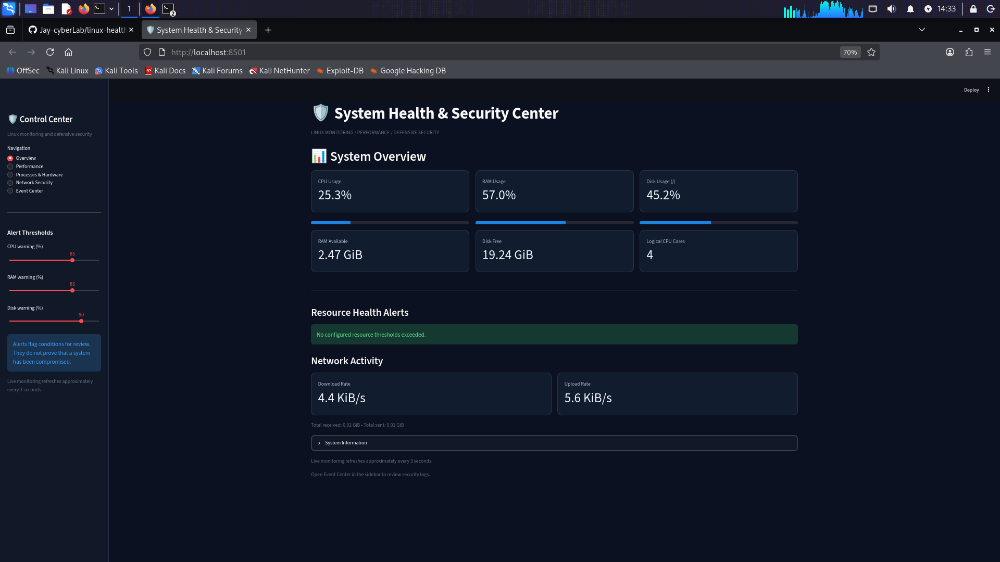
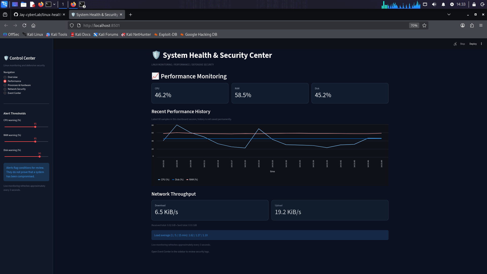
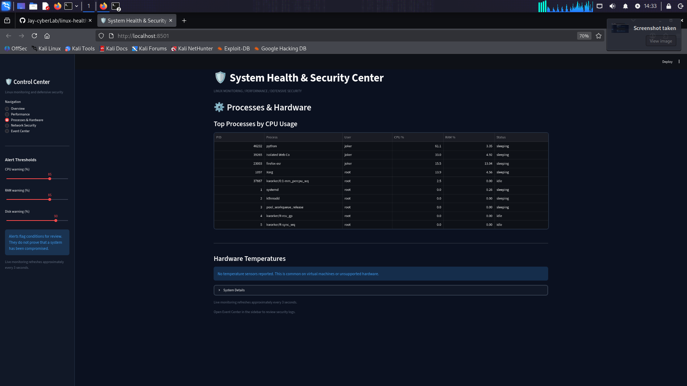
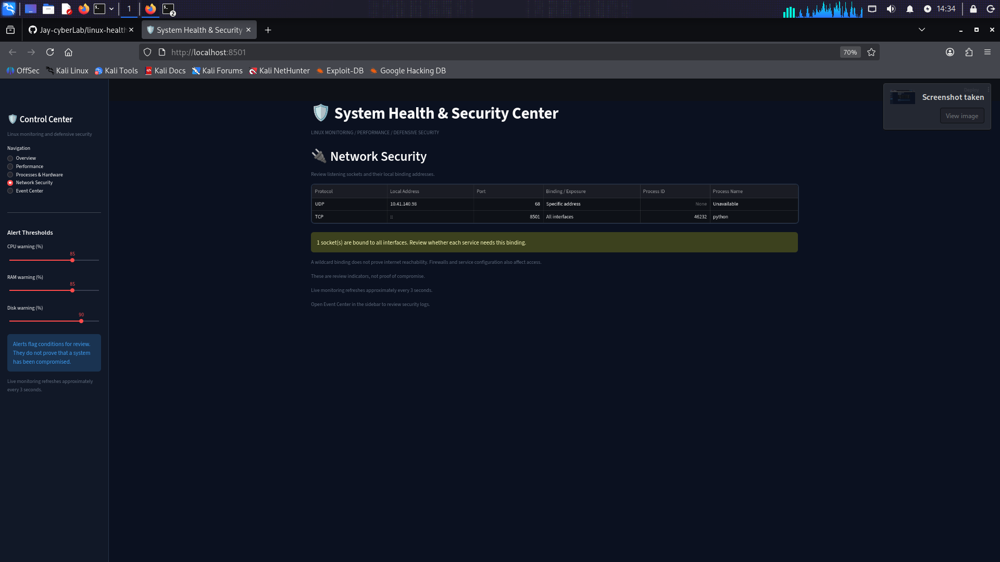
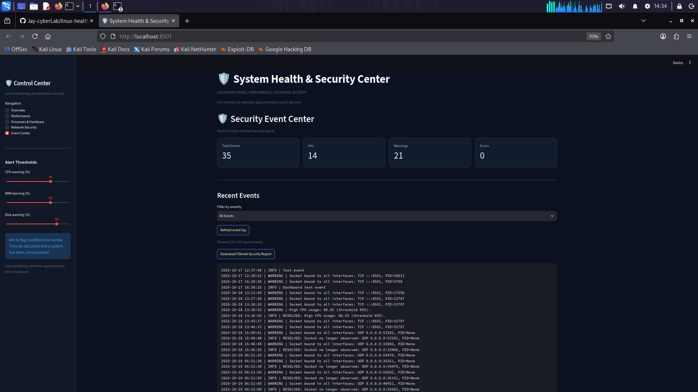

# Linux System Health Dashboard

A real-time Linux system monitoring dashboard built with Python, Streamlit, and psutil. Designed to help users observe system performance, review listening network ports, and track resource-related security events from a single interface.

## Features

- **Live system overview** — CPU, memory, disk, and network statistics.
- **Performance monitoring** — view recent resource usage history and network throughput.
- **Process and hardware information** — inspect running processes and available temperature readings.
- **Network security review** — review listening ports and flag services bound to all network interfaces.
- **Event center** — review logged resource warnings and network exposure events.
- **Configurable thresholds** — set CPU, memory, and disk usage warning levels.
- **Event export** — download filtered event records for further review.


## Dashboard Screenshots

### Overview


### Performance Monitoring


### Processes and Hardware


### Network Security


### Security Event Logs


## Built With

- Python
- Streamlit
- psutil

## Project Structure

```text
linux-health-dashboard/
├── app.py
├── monitor.py
├── security_logger.py
├── requirements.txt
├── README.md
└── .gitignore
```

Runtime logs and the Python virtual environment are stored locally and excluded from version control.

## Requirements

- Linux system
- Python 3
- pip
- Git (for cloning or version control)

## Installation

### 1. Clone the repository

Replace `YOUR-USERNAME` with your GitHub username after creating the repository.

```bash
git clone https://github.com/YOUR-USERNAME/linux-health-dashboard.git
cd linux-health-dashboard
```

### 2. Create a virtual environment

```bash
python3 -m venv .venv
source .venv/bin/activate
```

### 3. Install dependencies

```bash
python -m pip install -r requirements.txt
```

### 4. Launch the dashboard

```bash
streamlit run app.py
```

Open the local URL shown in your terminal, usually:

```text
http://localhost:8501
```

To stop the dashboard, press `Ctrl+C` in the terminal.

## Usage Notes

- Adjust the resource warning thresholds in the dashboard to suit your system.
- Review listening ports and investigate unfamiliar services using trusted system tools.
- Event records are written locally by the application's security logger.
- Available temperature readings depend on the hardware, operating system, permissions, and virtual machine environment.

## Security and Limitations

This project is a system monitoring and review tool, not a complete intrusion detection system or a substitute for a firewall, endpoint protection, or security audit.

A listening port is not automatically malicious. Investigate unexpected services before taking action.

When running inside a virtual machine, the dashboard reports the resources and hardware information exposed to the guest operating system.

Do not commit private logs, credentials, tokens, or other sensitive information to a public repository.

## Future Improvements

- Add automated tests.
- Add historical data persistence.
- Improve event categorization and filtering.
- Add configurable alert notifications.
- Add dashboard screenshots and a system architecture diagram.

## License

This project is licensed under the MIT License. See the [LICENSE](LICENSE) file for details.
